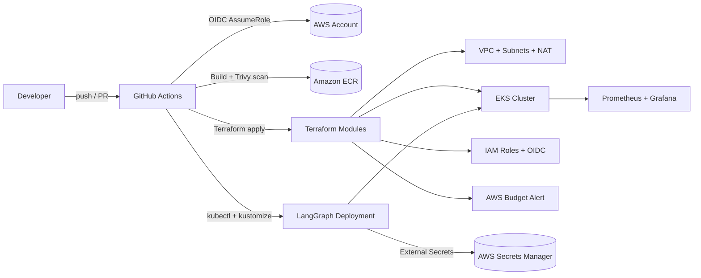

# eks-ai-platform

## Problem it solves

This repository provisions and deploys a secure, production-style baseline for running a LangGraph workload on Amazon EKS with:
- Terraform-managed infrastructure (VPC, EKS, ECR, IAM, budget guardrails)
- GitHub Actions CI/CD with OIDC-based AWS authentication (no long-lived keys)
- Kustomize deployment using External Secrets + AWS Secrets Manager
- Observability via Prometheus and Grafana

## Repository layout

```text
eks-ai-platform/
  terraform/          # root + modules for network, eks, ecr, iam
  k8s/                # kustomize manifests + monitoring Helm values
  .github/workflows/  # terraform checks/plan/apply + build/scan/push/deploy
  docs/               # architecture and decisions
  app/                # minimal LangGraph runtime container app
  Makefile
  README.md
```

## Architecture diagram



## Prerequisites

- Terraform >= 1.6
- AWS account and permissions to create EKS/VPC/IAM/ECR/Budgets
- kubectl, helm, kustomize
- tflint, checkov (for local checks)

## Configure and run

1. Copy Terraform vars and update values:
   ```bash
   cp terraform/terraform.tfvars.example terraform/terraform.tfvars
   ```
2. Set budget alert and tags **before first apply**.
3. Run local checks:
   ```bash
   make tf-fmt tf-validate tflint checkov
   ```
4. Deploy infrastructure:
   ```bash
   make tf-apply
   ```
5. Configure repository secrets/variables for workflows:
   - `AWS_TERRAFORM_ROLE_ARN` (secret)
   - `AWS_CI_ROLE_ARN` (secret)
   - `AWS_REGION` (variable)
   - `ECR_REPOSITORY` (variable)
   - `EKS_CLUSTER_NAME` (variable)
6. Create app secret in AWS Secrets Manager at `/eks-ai-platform/langgraph` with JSON:
   ```json
   {"openai_api_key":"<key>","model_name":"gpt-4o-mini"}
   ```
7. Run workflow `build-scan-push-deploy` or push to `main`.

## CI/CD overview

- **PR workflow**: `terraform-plan.yml`
  - `terraform fmt -check`
  - `terraform validate`
  - `tflint`
  - `checkov`
  - terraform plan (for non-fork PRs with OIDC)
- **Manual infra workflow**: `terraform-apply.yml` (`apply` or `destroy`)
- **App workflow**: `build-push-deploy.yml`
  - Docker build
  - Trivy image scan (HIGH/CRITICAL fail build)
  - push image to ECR
  - deploy to EKS with Kustomize

## Estimated cost

For a small always-on environment (2x `t3.medium` nodes + 1 NAT gateway + control plane), expect roughly **$6-12/day** depending on region and data transfer. Costs vary by workload and traffic. Review current AWS pricing and keep the budget alert enabled.

## Teardown

One command:

```bash
make teardown
```

This maps to `terraform destroy` and removes provisioned resources.

## Decisions and trade-offs

- **Kustomize for app deployment** keeps app manifests simple and CI-friendly.
- **External Secrets + Secrets Manager** avoids committing secrets.
- **OIDC IAM federation** eliminates long-lived AWS keys in GitHub.
- **Single NAT gateway** controls cost but is a single-AZ egress dependency.
- **Prometheus/Grafana** provides quick visibility for cluster and app metrics.

## Demo / screenshots

After deploying, capture:
- successful GitHub Actions runs (plan + deploy)
- EKS workloads (`kubectl get pods -n langgraph`)
- Grafana dashboard screenshot

Then run `make teardown` to avoid ongoing charges.
